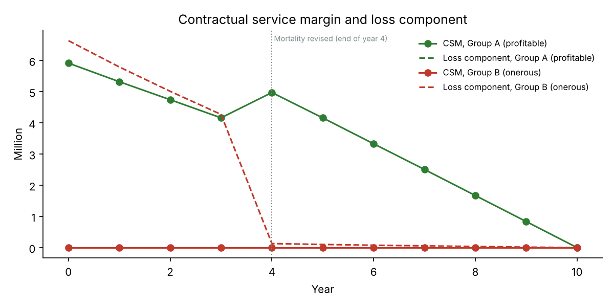
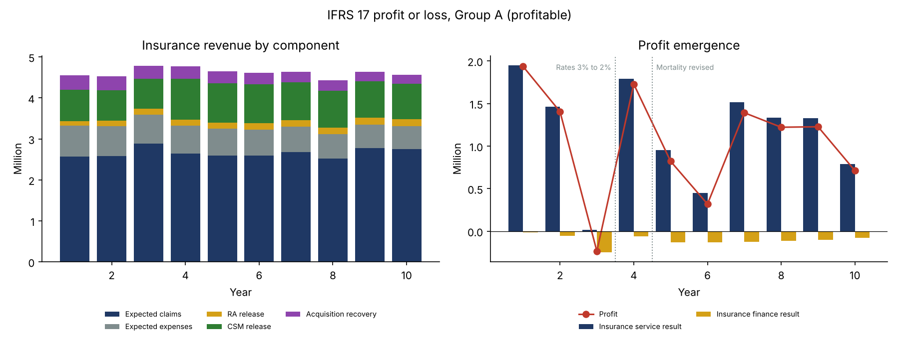
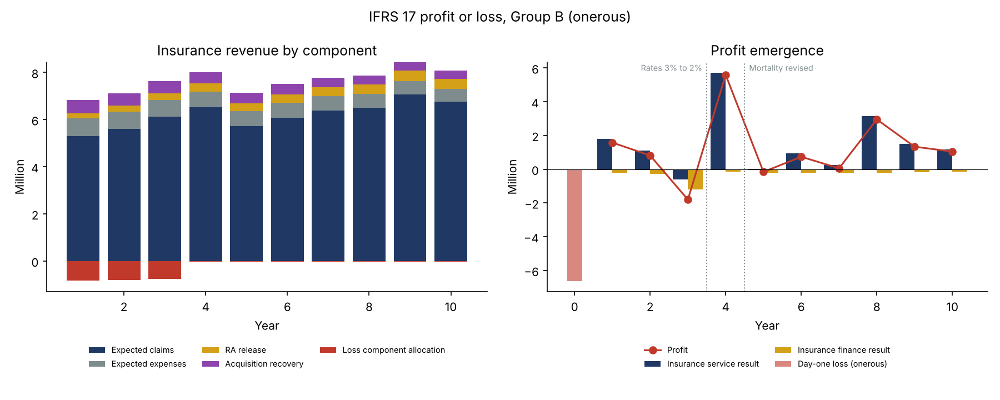

# IFRS 17 General Measurement Model Engine: from Cash Flows to Profit or Loss

A from-scratch Python implementation of the IFRS 17 General Measurement Model (GMM) for two groups of 10-year term life contracts, one profitable and one onerous, followed year by year from initial recognition to maturity:

- **Measurement:** best estimate liability (BEL), a confidence-level risk adjustment (RA) and the contractual service margin (CSM), or a loss component for the onerous group.
- **Subsequent measurement:** CSM interest accretion at the locked-in rate, adjustments for future service, release by coverage units, and loss component reversal.
- **Presentation:** insurance revenue, insurance service expenses, insurance service result and insurance finance expenses (IFRS 17.B120-B125).
- **Analysis of change** each year, with full reconciliation of the balance sheet movement.

Best-estimate mortality is based on real data: England & Wales males, 2011, from the Human Mortality Database, scaled to 70% for insured lives.

## Scenario

| Event | Timing | IFRS 17 treatment |
|---|---|---|
| Actual mortality 10% lighter than best estimate | Every year | Current-period claims variance: insurance service result. Effect on future cash flows (more policies in force): CSM |
| Random lapses (5% a year expected) | Every year | Effect on future cash flows: CSM |
| Discount rate falls from 3% to 2% | Valuation at end of year 3 | Insurance finance expense, **not** CSM |
| Best-estimate mortality revised to 90% | Valuation at end of year 4 | Change related to future service: **CSM** (Group A) or **loss component reversal** (Group B) |

## Key results

| | Group A (profitable) | Group B (onerous) |
|---|---|---|
| Issue age / annual premium | 40 / 566 | 50 / 896 |
| BEL at inception | -7.47m | 3.09m |
| Risk adjustment (75% confidence) | 1.55m | 3.55m |
| CSM at inception | 5.92m | 0 |
| Day-one loss | 0 | 6.64m |
| Lifetime IFRS 17 profit | 10.52m | 5.52m |
| Lifetime net cash flow | 10.52m | 5.52m |



**Reading the results:**

- **Group A is profitable at inception.** The expected profit (5.92m) is not recognised on day one: it is stored in the CSM and released as coverage is provided. When mortality is revised favourably at the end of year 4, the future profit increases, so the **CSM goes up** by 1.68m rather than booking an immediate gain.
- **Group B is onerous.** Including the risk adjustment, expected outflows exceed inflows, so IFRS 17 requires the **loss to be recognised immediately** (6.64m on day one). When mortality is revised at the end of year 4, the favourable change of 4.12m **reverses the loss component** and goes straight to profit. The CSM stays at zero, because a favourable change only rebuilds the CSM once the loss component is exhausted.
- **The rate fall at the end of year 3 does not touch the CSM.** It raises the BEL and hits insurance finance expenses (Group A's only loss year). Under IFRS 17, financial effects and service effects are kept separate.





## Validation

| Check | Group A | Group B |
|---|---|---|
| Annual reconciliation: change in liability = net cash flow - profit (largest gap) | 0.00 | 0.00 |
| Lifetime profit = lifetime net cash flow | 10,521,491 = 10,521,491 | 5,522,726 = 5,522,726 |
| CSM and loss component at maturity | 0 / 0 | 0 / 0 |
| BEL at inception vs independent policy-by-policy simulation (4,000 portfolios) | -7.47m vs -7.50m (0.8 SE) | 3.09m vs 3.08m (0.2 SE) |

- **The annual reconciliation proves completeness.** Every movement of the liability is explained, by cash, by the CSM, by the insurance service result or by insurance finance expenses. Nothing is lost or counted twice.
- **The lifetime identity holds** because the liability starts and ends at zero: over the life of a group, IFRS 17 only changes **when** profit is recognised, not **how much**.
- **The BEL recursion is asserted every year.** The expected run-off of the opening BEL, with interest, must equal a fresh valuation on the expected in-force.

## Method

**Cash flows.** Premiums and maintenance expenses (inflating at 2%) are paid at the start of each year and death claims at the end. Lapses happen at the end of the year among survivors, and the commission (50% of the first premium) is paid at inception.

**Risk adjustment.** A confidence-level approach: the 75th percentile minus the mean of the PV of future cash flows, under lognormal uncertainty on the mortality level (10%) and the lapse level (20%). The same scenarios are reused at every date, which keeps the RA smooth over time.

**CSM.**

```math
\text{CSM}_{t+1} = \left(\text{CSM}_t (1 + r_0) - \Delta \text{FCF}^{\text{future service}}_{r_0}\right)\left(1 - \frac{CU_t}{CU_t + \sum_{s>t} CU_s}\right)
```

- r_0 is the locked-in rate.
- Changes in fulfilment cash flows related to future service are measured at r_0; the gap with the current-rate measure goes to insurance finance expenses.
- Coverage units are the sum assured in force.
- If the bracket turns negative, the excess becomes a loss and builds a loss component, which favourable changes reverse first.

**Insurance revenue.** Expected claims + expected expenses + RA release + CSM release + recovery of acquisition cash flows. The loss component allocation is deducted from both revenue and expenses (presentation only, IFRS 17.50(a)).

## Simplifications

- One annual cohort per group, a flat discount rate, and no OCI option: all finance effects go to profit or loss.
- The RA is split into a release (service result) and a rate effect (finance); RA unwinding is not separated.
- The loss component is allocated systematically using coverage units, an approximation of IFRS 17.50(a).
- No investment component, no reinsurance held, and coverage units are not discounted.

## Repository structure

```
├── run_study.py        # both groups, validations, tables and charts
├── data/
│   └── mortality_ew_male_2011.csv
├── src/
│   ├── cashflows.py    # products, projection, risk adjustment, coverage units
│   └── gmm.py          # GMM roll-forward, CSM, loss component, presentation
└── results/
    ├── figures/
    ├── tables/         # annual results per group, summary and validation
    └── run_log.txt
```

## How to run

```bash
pip install -r requirements.txt
python run_study.py
```

## Next steps

- Variable Fee Approach (VFA) for participating contracts, and the Premium Allocation Approach (PAA) for short-term business.
- A yield curve with an OCI option, and disclosure tables (IFRS 17.101-105 roll-forwards).
- Reinsurance contracts held, with a loss-recovery component.
- A comparison with Solvency II: risk margin versus RA, and CSM versus own funds.

## References

- IFRS Foundation (2017, amended 2020). *IFRS 17 Insurance Contracts*.
- Human Mortality Database, University of California, Berkeley (USA) and Max Planck Institute for Demographic Research (Germany), www.mortality.org.

---

**Author:** Yassine El Bakali, MSc in Actuarial Science (ULB) · yelbakali@yahoo.be
